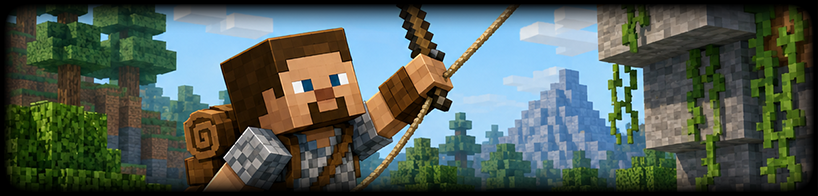
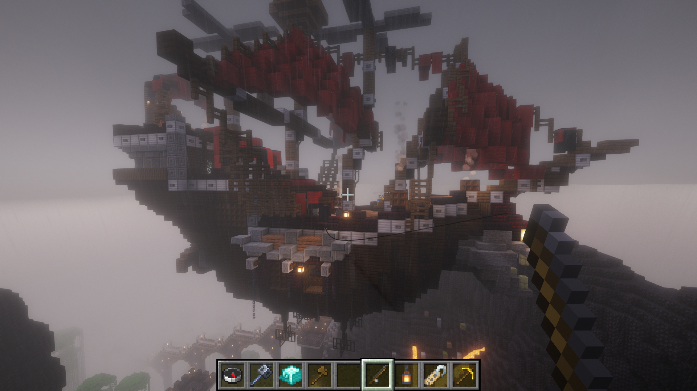

<p align="center">
  
</p>
<h1 align="center">Cobbleworks - Hookshot Plugin</h1>
<p align="center">
  <b>Turn ordinary fishing rods into configurable grappling hooks for exploration and mobility.</b><br>
  <b>Pull toward blocks, retrieve nearby mobs, and tune every player's range, speed, boost, and effects.</b>
</p>
<p align="center">
  <a href="https://github.com/Cobbleworks/Hookshot-Plugin/releases"></a>&nbsp;&nbsp;<a href="https://github.com/Cobbleworks/Hookshot-Plugin/blob/main/LICENSE"></a>&nbsp;&nbsp;&nbsp;&nbsp;&nbsp;&nbsp;&nbsp;&nbsp;<a href="https://github.com/Cobbleworks/Hookshot-Plugin/issues"></a>
</p>

Hookshot gives each player a grappling mode for ordinary fishing rods. Hooks that strike a block pull the player toward the impact point; hooks that catch a non-player living entity pull that entity toward the player. Range, speed, boost, effects, and throw velocity are stored per player.

## **Core Features**

- Pull toward blocks or retrieve non-player living entities
- Per-player range, pull speed, vertical boost, and hook velocity
- Optional sound and particle feedback
- Server-controlled defaults and value limits
- Persistent player settings in `playerdata.yml`
- No external dependencies

## **Supported Platforms**

- **Server software:** Spigot, Paper, Purpur, and compatible forks
- **Minecraft:** 1.19 or newer
- **Java:** 17 or newer
- **Dependencies:** None

## **Table of Contents**

1. [Core Features](#core-features)
2. [Supported Platforms](#supported-platforms)
3. [Getting Started](#getting-started)
4. [Third-Party Plugins](#third-party-plugins)
5. [How It Works](#how-it-works)
   - [Block Grappling](#block-grappling)
   - [Entity Grappling](#entity-grappling)
6. [Configuration](#configuration)
7. [Commands](#commands)
8. [Permissions](#permissions)
9. [Data and Operational Notes](#data-and-operational-notes)
10. [Building from Source](#building-from-source)
11. [License](#license)
12. [Screenshots](#screenshots)

## **Getting Started**

1. Download the latest JAR from [Releases](https://github.com/Cobbleworks/Hookshot-Plugin/releases).
2. Stop the server and copy the JAR into `plugins/`.
3. Start the server to generate `plugins/Hookshot/config.yml` and `playerdata.yml`.
4. Hold a fishing rod and run `/hookshot` to enable grappling mode.
5. Cast at a block within range to test the pull.

When grappling mode is disabled, fishing rods retain their normal behavior.

For a comfortable first setup, keep the default range and speed, practice on a low structure, and use `/hookshot info` before changing values. The movement is applied as player velocity, so fall damage, protected regions, and server anti-cheat settings still behave according to the rest of the server configuration.

## **Third-Party Plugins**

No third-party plugins are required. Hookshot is self-contained.

## **How It Works**

### **Block Grappling**

The hook's launch velocity is multiplied by the player's configured value. When it hits a block, Hookshot checks the distance, applies the configured pull speed toward the impact point, and adds vertical boost to help clear ledges. Hits beyond the configured range are rejected.

### **Entity Grappling**

Catching a living entity other than a player reverses the pull: the entity moves toward the caster. Entity pulls use slightly stronger horizontal and vertical multipliers than block pulls. Players cannot be pulled with this mechanic.

A 250 ms per-player cooldown prevents duplicate hit events from stacking velocity.

## **Configuration**

`config.yml` controls the defaults assigned to new players and the limits accepted by setting commands.

| Key | Default | Purpose |
|-----|---------|---------|
| `default-range` | `30.0` | Maximum hook distance in blocks |
| `pull-speed` | `2.0` | Player pull velocity multiplier |
| `vertical-boost` | `0.3` | Upward force added to a pull |
| `hook-velocity-multiplier` | `2.0` | Fishing-hook launch velocity |
| `play-sound` | `true` | Default sound preference |
| `show-particles` | `true` | Default particle preference |
| `min-range` / `max-range` | `10.0` / `100.0` | Allowed range values |
| `min-pull-speed` / `max-pull-speed` | `0.5` / `5.0` | Allowed pull-speed values |
| `min-vertical-boost` / `max-vertical-boost` | `0.0` / `1.5` | Allowed boost values |
| `min-hook-velocity` / `max-hook-velocity` | `1.0` / `5.0` | Allowed launch-velocity values |

Configuration changes apply after a restart. Existing players keep their stored values until they change them or use `/hookshot reset`.

## **Commands**

**Root command:** `/hookshot`
**Aliases:** `/hook`, `/grapple`

| Command | Description |
|---------|-------------|
| `/hookshot` or `/hookshot toggle` | Enable or disable grappling mode |
| `/hookshot range <value>` | Set the maximum pull range |
| `/hookshot speed <value>` | Set player/entity pull strength |
| `/hookshot boost <value>` | Set additional upward momentum |
| `/hookshot velocity <value>` | Set hook launch velocity |
| `/hookshot sound` | Toggle personal pull sounds |
| `/hookshot particles` | Toggle personal pull particles |
| `/hookshot reset` | Restore current server defaults |
| `/hookshot info` | Display personal settings |

Hookshot commands are player-only; they cannot be run from the console.

## **Permissions**

| Permission | Description | Default |
|------------|-------------|---------|
| `hookshot.use` | Use grappling mode and basic commands | `true` |
| `hookshot.settings` | Change personal range, speed, boost, velocity, sound, and particles | `true` |
| `hookshot.admin` | Reserved administrative access | `op` |

## **Data and Operational Notes**

- `playerdata.yml` stores settings by player UUID and is managed automatically.
- Settings are saved when changed and during plugin shutdown.
- A player must retain `hookshot.use`; removing it disables grappling even if their saved mode is enabled.
- Very high speed and boost limits can cause fall damage or anti-cheat alerts, so raise server limits carefully.

## **Building from Source**

Requirements: Java 17 or newer and Maven 3.6 or newer.

```bash
git clone https://github.com/Cobbleworks/Hookshot-Plugin.git
cd Hookshot-Plugin
mvn clean verify
```

The packaged plugin is written to `target/`.

## **License**

Hookshot is released under the [MIT License](LICENSE).

## **Screenshots**

<table>
  <tr>
    <th>Hookshot - Battleship Bowser Climb</th>
    <th>Hookshot - Range Configuration</th>
  </tr>
  <tr>
    <td><a href="https://github.com/Cobbleworks/Hookshot-Plugin/raw/main/images/screenshot-battleship-bowser.png"></a></td>
    <td><a href="https://github.com/Cobbleworks/Hookshot-Plugin/raw/main/images/screenshot-range-configuration.png"></a></td>
  </tr>
  <tr>
    <th>Hookshot - Industry Crane</th>
    <th>Hookshot - Desert Town</th>
  </tr>
  <tr>
    <td><a href="https://github.com/Cobbleworks/Hookshot-Plugin/raw/main/images/screenshot-industry-crane.png"></a></td>
    <td><a href="https://github.com/Cobbleworks/Hookshot-Plugin/raw/main/images/screenshot-desert-town.png"></a></td>
  </tr>
  <tr>
    <th>Hookshot - Lava Dungeon</th>
    <th>Hookshot - Jungle House</th>
  </tr>
  <tr>
    <td><a href="https://github.com/Cobbleworks/Hookshot-Plugin/raw/main/images/screenshot-lava-dungeon.png"></a></td>
    <td><a href="https://github.com/Cobbleworks/Hookshot-Plugin/raw/main/images/screenshot-jungle-house.png"></a></td>
  </tr>
</table>
