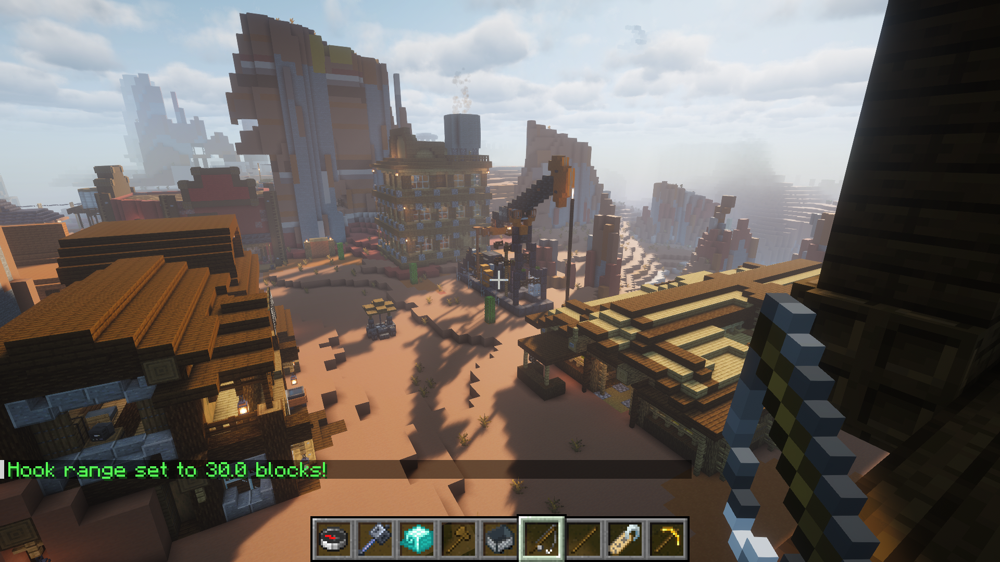
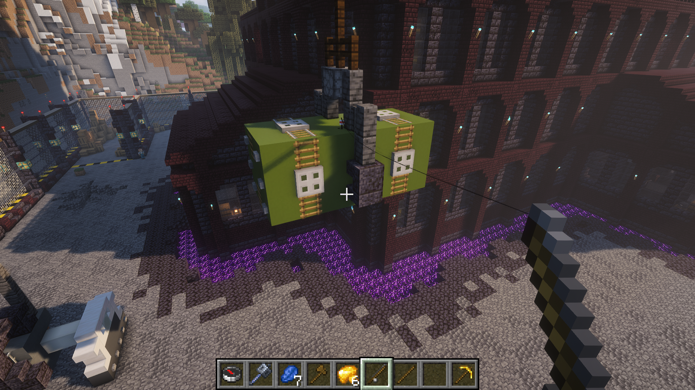
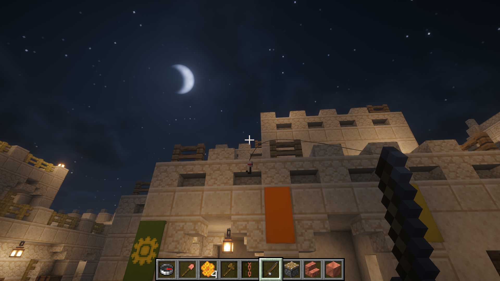
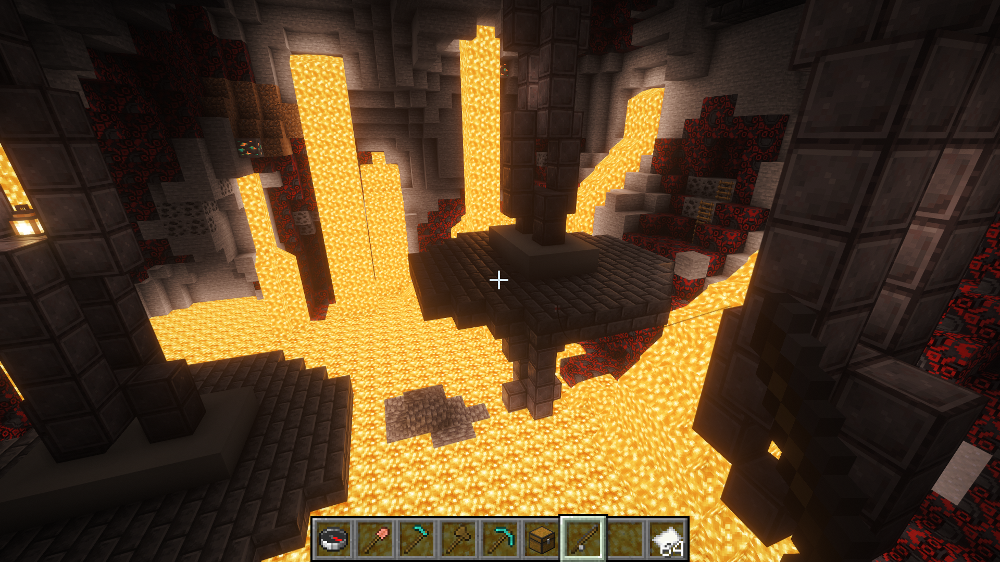
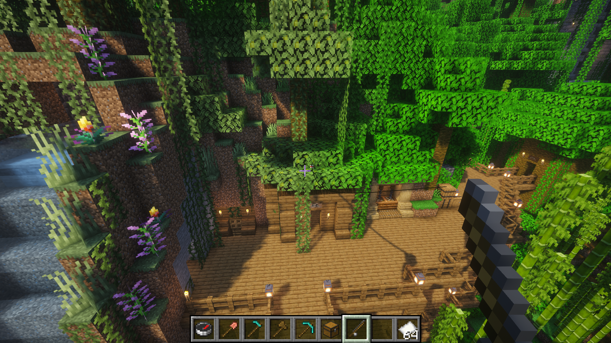

<p align="center">
  
</p>
<h1 align="center">Cobbleworks - Hookshot Plugin</h1>
<p align="center">
  <b>A wearable grapple harness with rope-swing physics for fast, fluid movement.</b><br>
  <b>Fire two hooks at anything, swing, reel in with gas, let go at speed, and land momentum-powered strikes.</b>
</p>
<p align="center">
  <a href="https://github.com/Cobbleworks/Hookshot-Plugin/releases"></a>&nbsp;&nbsp;<a href="https://github.com/Cobbleworks/Hookshot-Plugin/blob/main/LICENSE"></a>&nbsp;&nbsp;&nbsp;&nbsp;&nbsp;&nbsp;&nbsp;&nbsp;<a href="https://github.com/Cobbleworks/Hookshot-Plugin/issues"></a>
</p>

Hookshot adds a **Grapple Harness**: leggings that fire hooks from the hips. Both hands stay free, so you can hold a sword while you swing. Hooks anchor to any solid block or to mobs. A rope simulation runs every tick, so you can swing, reel in, steer in mid-air, and keep your momentum when you let go.

## **Core Features**

- Wearable harness in the leggings slot, so both hands stay free
- Up to two hooks at once that anchor to blocks, mobs, and vehicles
- Real rope physics: pendulum swings, reeling, and momentum carried after release
- Air control with W/A/S/D while swinging
- A gas supply for reeling and mid-air bursts that refills on the ground
- Bonus melee damage when striking at speed
- Smooth rope rendering with display entities
- Craftable, or handed out with `/hookshot give`
- No external dependencies

## **Supported Platforms**

- **Server software:** Paper and Paper forks (Folia is not supported)
- **Minecraft:** 26.2 or newer
- **Java:** 25 or newer
- **Dependencies:** None

## **Table of Contents**

1. [Core Features](#core-features)
2. [Supported Platforms](#supported-platforms)
3. [Getting Started](#getting-started)
4. [Controls](#controls)
5. [How It Works](#how-it-works)
   - [Rope Physics](#rope-physics)
   - [Gas](#gas)
   - [Combat](#combat)
6. [Crafting](#crafting)
7. [Configuration](#configuration)
8. [Commands](#commands)
9. [Permissions](#permissions)
10. [Operational Notes](#operational-notes)
11. [Building from Source](#building-from-source)
12. [License](#license)
13. [Screenshots](#screenshots)

## **Getting Started**

1. Download the latest JAR from [Releases](https://github.com/Cobbleworks/Hookshot-Plugin/releases).
2. Stop the server and copy the JAR into `plugins/`.
3. Start the server to generate `plugins/Hookshot/config.yml`.
4. Craft a Grapple Harness, or run `/hookshot give`.
5. Put the harness on in the leggings slot, hold a sword, aim at a wall, and **right-click**.

To get the feel for it, fire a hook at a high wall, walk off a ledge, and let the rope swing you. Then hold **Sneak** to reel in, and let go of **Sneak** to release the rope and fly on with your momentum.

## **Controls**

| Input | Action |
|-------|--------|
| **Right-click** with a sword | Fire a hook where you aim (click again for each hook; holding the button does not repeat). With two hooks out, a new one replaces the oldest. |
| **Hold Sneak** | Reel in toward your hooks (uses gas). Fully reeled in, you hang on the spot for free. |
| **Release Sneak** after reeling | Let go and keep your momentum (`controls.release-on-sneak-release`) |
| **Jump** with hooks out | Let go: in mid-air you keep your momentum, on the ground you just jump |
| **Jump** in mid-air with no hooks out | Gas burst in the direction you look |
| **W / A / S / D** in mid-air | Steer and pump your swing |
| **Attack** | Normal melee, with bonus damage at high speed |

While the harness is worn and you hold any sword, right-click fires hooks instead of interacting with blocks (doors, chests, etc.). Switch to another item to use blocks normally.

The action bar shows your gas tank and one diamond per hook slot:

| Diamond | Meaning |
|---------|---------|
| Gray | Hook slot free |
| Yellow | Hook in flight |
| Green | Hook anchored |

When you stand on the ground while hooked, the rope stays out for `hooks.auto-retract-ground-ticks` (2 seconds by default) and then retracts. Hold **Sneak** during that time to reel yourself up. Firing a hook and swinging without touching Sneak keeps the rope out until you press Jump.

## **How It Works**

### **Rope Physics**

A fired hook flies to the target point (`hooks.travel-speed`) and anchors there. From then on, the server simulates your movement every tick and sends you the result:

- **Swinging:** the rope keeps you within its length of the anchor. You move freely around the anchor but cannot fly away from it, which is what makes a pendulum swing.
- **Reeling:** holding Sneak shortens the rope and pulls you toward the anchor. With two hooks, you are pulled between them.
- **Momentum:** air drag is much lower than vanilla (`movement.air-drag`), so swings keep their speed. When you let go, that momentum carries for `movement.momentum-ticks` before vanilla physics take over.
- **Ground:** on the ground the rope pays out freely, so you can walk around while hooked. It stays slack when you step off the ground until you drop `rope.ground-slack-drop` below where you left it, so steps, stairs, and small hops never yank you back. Running off a real ledge still starts a swing. Hooks retract on their own after `hooks.auto-retract-ground-ticks`.

Hooks break when the anchor block is broken, the hooked entity dies, or the entity pulls too far away. Mobs, boats, minecarts, and item frames can be hooked. Other players can only be hooked when `hooks.hook-players` is on.

### **Gas**

Reeling uses gas every tick (hanging at full reel is free), and a mid-air burst uses a chunk at once. Swinging and firing hooks are free. Gas refills while you stand on the ground, after a short delay. When the tank is empty you can still swing, but you can't reel or burst.

### **Combat**

Melee hits land harder when you are moving fast. Above `combat.speed-threshold` (sprinting is about 0.28 blocks/tick), every extra block per tick adds `combat.bonus-per-speed` damage, capped at `combat.max-bonus`. Wearing the harness also scales fall damage by `combat.fall-damage-multiplier`, and you take no fall damage while hanging on a rope.

## **Crafting**

The default shaped recipe:

```
[Tripwire Hook] [Iron Chain]      [Tripwire Hook]
[Iron Ingot]    [Leather Leggings] [Iron Ingot]
[Wind Charge]   [ empty ]         [Wind Charge]
```

The wind charges act as the gas canisters. Players unlock the recipe in the recipe book when they join. You can change the shape and ingredients under `recipe` in `config.yml`, or set `recipe.enabled: false` to make the harness command-only.

## **Configuration**

All values are in blocks and ticks (20 ticks = 1 second). Apply changes with `/hookshot reload`.

| Key | Default | Purpose |
|-----|---------|---------|
| `harness.material` / `harness.color` / `harness.name` | `LEATHER_LEGGINGS` / `#3B2F2F` / `Grapple Harness` | Harness item appearance |
| `recipe.enabled` / `recipe.shape` / `recipe.ingredients` | see above | Crafting recipe |
| `controls.release-on-sneak-release` | `true` | Letting go of Sneak after reeling also lets go of the hooks |
| `hooks.range` | `40.0` | Maximum firing distance |
| `hooks.max-hooks` | `2` | Hooks out at once (1-4) |
| `hooks.travel-speed` | `4.0` | Hook flight speed per tick |
| `hooks.fire-cooldown-ticks` | `4` | Delay between shots |
| `hooks.hook-entities` / `hooks.hook-players` | `true` / `false` | What hooks may anchor to besides blocks |
| `hooks.auto-retract-ground-ticks` | `40` | Retract after standing this long (0 = never) |
| `rope.min-length` | `1.5` | Shortest reeled rope |
| `rope.reel-speed` / `rope.reel-acceleration` | `0.6` / `0.15` | Reeling strength |
| `rope.ground-slack-drop` | `1.25` | How far you can drop after stepping off the ground before the rope tightens |
| `rope.block` / `rope.width` | `GRAY_CONCRETE` / `0.05` | Rope appearance |
| `movement.air-drag` | `0.995` | Velocity kept per tick while swinging (vanilla is 0.91) |
| `movement.steer-acceleration` | `0.04` | W/A/S/D air control |
| `movement.max-speed` | `3.0` | Speed cap |
| `movement.momentum-ticks` | `40` | Momentum carry after letting go |
| `gas.capacity` | `100.0` | Tank size |
| `gas.reel-cost` | `0.5` | Gas per tick of reeling |
| `gas.burst-enabled` / `gas.burst-cost` / `gas.burst-power` / `gas.burst-cooldown-ticks` | `true` / `20.0` / `1.1` / `10` | Mid-air gas burst |
| `gas.regen-per-tick` / `gas.regen-delay-ticks` | `1.0` / `20` | Refill on the ground |
| `combat.momentum-damage` | `true` | Speed-based melee bonus |
| `combat.speed-threshold` / `combat.bonus-per-speed` / `combat.max-bonus` | `0.7` / `0.6` / `1.0` | Bonus curve |
| `combat.fall-damage-multiplier` | `0.5` | Fall damage while wearing the harness |
| `effects.sounds` / `effects.particles` | `true` / `true` | Feedback effects |

Out-of-range values are clamped to safe limits, and invalid materials fall back to the defaults with a console warning.

## **Commands**

**Root command:** `/hookshot`
**Aliases:** `/hook`, `/grapple`

| Command | Description | Permission |
|---------|-------------|------------|
| `/hookshot` or `/hookshot help` | Show the controls | none |
| `/hookshot give [player] [amount]` | Give harnesses (amount 1-64) | `hookshot.give` |
| `/hookshot reload` | Reload `config.yml` and the recipe | `hookshot.reload` |

`give` and `reload` also work from the console. From the console, `give` needs a player name.

## **Permissions**

| Permission | Description | Default |
|------------|-------------|---------|
| `hookshot.use` | Use a worn harness | `true` |
| `hookshot.give` | Give harnesses | `op` |
| `hookshot.reload` | Reload the configuration | `op` |
| `hookshot.admin` | Grants `hookshot.give` and `hookshot.reload` | `op` |

## **Operational Notes**

- **Anti-cheat:** grappling moves players faster than vanilla allows. Movement checks in anti-cheat plugins may flag it, so add an exemption for harness users if needed.
- **Flight kick protection:** hanging still on a rope looks like flying to the vanilla anti-fly check. While a player hangs on a rope, Hookshot temporarily allows flight and blocks real flight from being turned on. It switches this off when the player lets go. It is also cleaned up on rejoin if the server stopped mid-swing.
- **Latency:** the rope simulation runs on the server, so players with high ping may notice a slight delay when a swing starts or stops.
- **Teleports:** hooks are released on death, world changes, and teleports over 4 blocks.
- **Upgrading from 1.x:** the fishing-rod mode and per-player settings are gone. You can delete the old `playerdata.yml`. Old keys in `config.yml` are ignored; regenerate the file to see the new options.

## **Building from Source**

Requirements: Java 25 or newer and Maven 3.8 or newer.

```bash
git clone https://github.com/Cobbleworks/Hookshot-Plugin.git
cd Hookshot-Plugin
mvn clean verify
```

The packaged plugin is written to `target/`.

## **License**

Hookshot is released under the [MIT License](LICENSE).

## **Screenshots**

<table>
  <tr>
    <th>Hookshot - Battleship Bowser Climb</th>
    <th>Hookshot - Range Configuration</th>
  </tr>
  <tr>
    <td><a href="https://github.com/Cobbleworks/Hookshot-Plugin/raw/main/images/screenshot-battleship-bowser.png"></a></td>
    <td><a href="https://github.com/Cobbleworks/Hookshot-Plugin/raw/main/images/screenshot-range-configuration.png"></a></td>
  </tr>
  <tr>
    <th>Hookshot - Industry Crane</th>
    <th>Hookshot - Desert Town</th>
  </tr>
  <tr>
    <td><a href="https://github.com/Cobbleworks/Hookshot-Plugin/raw/main/images/screenshot-industry-crane.png"></a></td>
    <td><a href="https://github.com/Cobbleworks/Hookshot-Plugin/raw/main/images/screenshot-desert-town.png"></a></td>
  </tr>
  <tr>
    <th>Hookshot - Lava Dungeon</th>
    <th>Hookshot - Jungle House</th>
  </tr>
  <tr>
    <td><a href="https://github.com/Cobbleworks/Hookshot-Plugin/raw/main/images/screenshot-lava-dungeon.png"></a></td>
    <td><a href="https://github.com/Cobbleworks/Hookshot-Plugin/raw/main/images/screenshot-jungle-house.png"></a></td>
  </tr>
</table>
