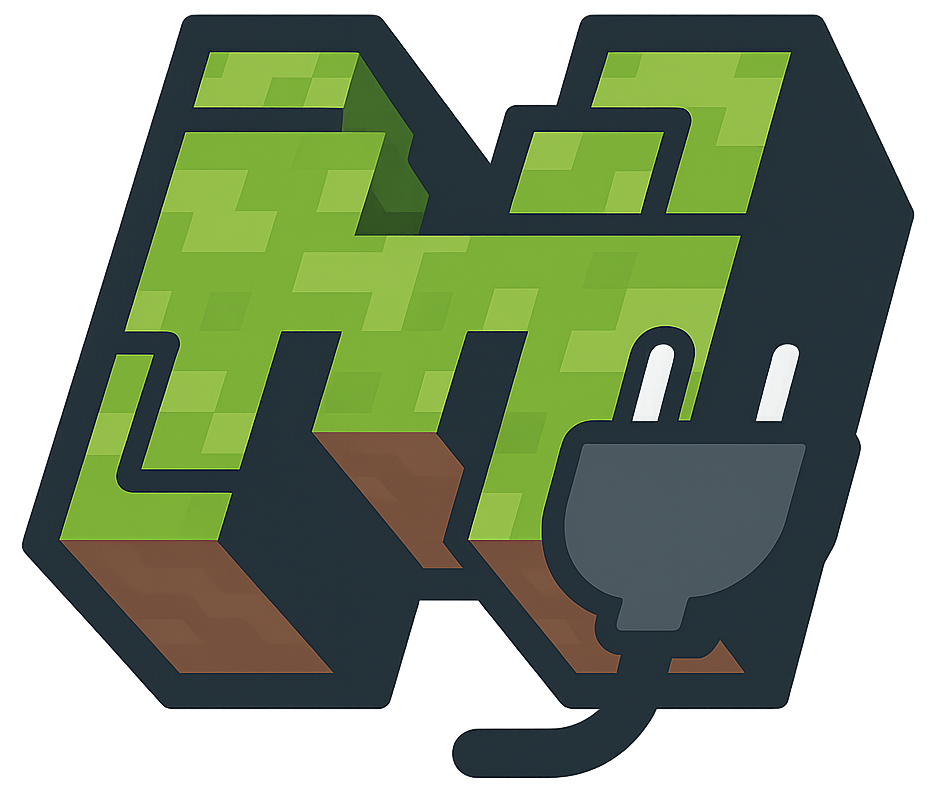

  

<h1 align="center">Hookshot</h1>

  <b>Transform fishing rods into configurable grappling hooks.</b> 
  <b>Per-player settings for range, velocity, sound, particles, and vertical boost.</b>

  &nbsp;&nbsp;&nbsp;&nbsp;&nbsp;&nbsp;&nbsp;&nbsp;&nbsp;&nbsp;

Hookshot is an open-source Minecraft plugin that transforms fishing rods into fully configurable grappling hooks. Players toggle the grappling mode on demand: when enabled, casting a fishing rod launches the hook at the player's configured throw velocity — and upon hitting a block or catching a non-player living entity, the player is immediately pulled toward the hook's landing position with a configurable pull speed and vertical boost. All per-player settings (range, speed, boost, velocity, sound, particles) are saved persistently in `playerdata.yml` and survive server restarts.

### **Core Features**

- **Toggle Mode:** Each player independently enables or disables grappling hook mode — normal fishing is unaffected when mode is off
- **Block Grappling:** When the hook lands on a block, the player is instantly pulled toward that position if within the configured range
- **Entity Grappling:** When the hook catches a non-player living entity, the player is pulled toward that entity (can be used to retrieve mobs)
- **Configurable Throw Velocity:** Adjustable hook throw speed (1.0–5.0) controls how far and how fast the hook travels
- **Configurable Pull Speed:** Adjustable pull speed (0.5–5.0) sets how quickly the player is pulled toward the hook
- **Vertical Boost:** Optional upward momentum (0.0–1.5) applied on pull to help clear obstacles during movement
- **Range Limit:** Configurable maximum hook range per player (10–100 blocks); hook is cancelled if the landing point exceeds the player's set range
- **Pull Cooldown:** A 250ms minimum gap between consecutive pulls prevents rubber-banding exploits
- **Sound Effects:** Optional sound feedback on pull, toggleable per-player
- **Particle Effects:** Optional particle trail on pull, toggleable per-player
- **Persistent Per-Player Settings:** All settings are stored in `plugins/Hookshot/playerdata.yml` and loaded on join
- **Reset Command:** Instantly restore all personal settings to the server-configured defaults

### **Supported Platforms**

- **Server Software:** `Spigot`, `Paper`, `Purpur`, `CraftBukkit`
- **Minecraft Versions:** `1.19` and higher
- **Java Requirements:** `Java 17+`

### **Installation**

1. Download the latest `.jar` from the [Releases](https://github.com/Cobbleworks/Hookshot-Plugin/releases) page
2. Stop your Minecraft server
3. Copy the `.jar` into your server's `plugins/` folder
4. Start the server — the plugin generates `plugins/Hookshot/` containing `config.yml` and `playerdata.yml`
5. Edit `config.yml` to set the server-wide defaults and per-player limits, then reload with `/hookshot reload` (or restart)

### **Configuration**

All settings are in `plugins/Hookshot/config.yml`. These values define both the server defaults for new players and the configurable limits that players may not exceed:

| Key | Default | Description |
|-----|---------|-------------|
| `default-range` | `30.0` | Default hook range in blocks for new players |
| `pull-speed` | `2.0` | Default pull speed (how fast the player is pulled) |
| `vertical-boost` | `0.3` | Default upward momentum applied on pull |
| `hook-velocity-multiplier` | `2.0` | Default hook throw speed multiplier |
| `play-sound` | `true` | Whether sound is enabled by default for new players |
| `show-particles` | `true` | Whether particles are enabled by default for new players |
| `min-range` | `10.0` | Minimum range players are allowed to set |
| `max-range` | `100.0` | Maximum range players are allowed to set |
| `min-pull-speed` | `0.5` | Minimum pull speed players are allowed to set |
| `max-pull-speed` | `5.0` | Maximum pull speed players are allowed to set |
| `min-vertical-boost` | `0.0` | Minimum vertical boost players are allowed to set |
| `max-vertical-boost` | `1.5` | Maximum vertical boost players are allowed to set |
| `min-hook-velocity` | `1.0` | Minimum hook throw velocity players are allowed to set |
| `max-hook-velocity` | `5.0` | Maximum hook throw velocity players are allowed to set |

### **Player Commands**

| Command | Description |
|---------|-------------|
| `/hookshot` | Toggle grappling hook mode on or off (same as `toggle`) |
| `/hookshot toggle` | Toggle grappling hook mode on or off |
| `/hookshot range <value>` | Set your hook range in blocks (server min–max limits apply) |
| `/hookshot speed <value>` | Set your pull speed (how quickly you are pulled toward the hook) |
| `/hookshot boost <value>` | Set your vertical boost amount (upward momentum on pull) |
| `/hookshot velocity <value>` | Set your hook throw velocity (how far and fast the hook is launched) |
| `/hookshot sound` | Toggle sound effects on or off |
| `/hookshot particles` | Toggle particle effects on or off |
| `/hookshot reset` | Reset all your personal settings to the server default values |
| `/hookshot info` | Display your current hookshot settings (status, range, speed, boost, velocity, sound, particles) |

**How to use:** Hold a fishing rod and right-click to cast. When hookshot mode is enabled, the rod behaves as a grappling hook instead of a fishing rod. Range, pull speed, and other settings can be adjusted per-player. Casting while out of range shows a range error message and the pull is cancelled.

**Aliases:** `/hook`, `/grapple`

### **Permissions**

| Permission | Description | Default |
|------------|-------------|---------|
| `hookshot.use` | Allow a player to use the grappling hook | `true` |
| `hookshot.settings` | Allow a player to configure their hookshot settings (range, speed, boost, velocity, sound, particles) | `true` |
| `hookshot.admin` | Administrative access to hookshot features | `op` |

### **License**

This project is licensed under the **MIT License** — see the [LICENSE](LICENSE) file for details.

## **Screenshots**

The screenshots below demonstrate the core features of the Hookshot plugin, including the grappling hook mechanics, player settings, particle effects, and extended range configuration.

<table>
  <tr>
    <th>Hookshot - Grappling Hook</th>
    <th>Hookshot - Player Settings</th>
  </tr>
  <tr>
    <td></td>
    <td></td>
  </tr>
  <tr>
    <th>Hookshot - Particle Effects</th>
    <th>Hookshot - Extended Range</th>
  </tr>
  <tr>
    <td></td>
    <td></td>
  </tr>
</table>
