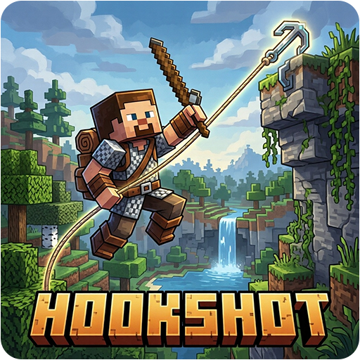

  

<h1 align="center">Hookshot</h1>

  <b>Transform fishing rods into configurable grappling hooks.</b> 
  <b>Per-player settings for range, velocity, sound, particles, and vertical boost.</b>

  &nbsp;&nbsp;&nbsp;&nbsp;&nbsp;&nbsp;&nbsp;&nbsp;&nbsp;&nbsp;

Hookshot is an open-source Minecraft plugin that transforms fishing rods into fully configurable grappling hooks. Players can toggle the grappling mode on demand, launch hooks that pull them toward the landing location, and fine-tune every aspect of the experience — hook range, pull speed, vertical boost, throw velocity, particle effects, and sound feedback. All settings are saved per-player and persist across server restarts.

### **Core Features**

- **Toggle System:** Players can enable or disable the grappling hook individually without affecting other players
- **Fully Customizable:** Each player can configure all grappling hook parameters to their preferred playstyle
- **Extended Range:** Hooks travel further than normal fishing rods — configurable from 10 to 100 blocks
- **Pull Mechanics:** Players are pulled toward where the hook lands with fully adjustable pull speed
- **Per-Player Configuration:** All settings are saved per-player and persist through server restarts
- **Sound & Particle Effects:** Audio and visual feedback on hook launch and pull, both fully toggleable per-player
- **Vertical Boost:** Configurable upward momentum applied when being pulled for dynamic movement
- **Reset Command:** Instantly restore all personal settings to server defaults with a single command

### **Supported Platforms**

- **Server Software:** `Spigot`, `Paper`, `Purpur`, `CraftBukkit`
- **Minecraft Versions:** `1.21.5`, `1.21.6`, `1.21.7`, `1.21.8`, `1.21.9`, `1.21.10` and higher
- **Java Requirements:** `Java 17+`

### **Installation**

1. Download the latest `.jar` from the [Releases](https://github.com/Cobbleworks/Hookshot-Plugin/releases) page
2. Stop your Minecraft server
3. Copy the `.jar` into your server's `plugins` folder
4. Start your server — a default configuration folder is generated at `plugins/Hookshot/`

### **Player Commands**

| Command | Description |
|---------|-------------|
| `/hookshot` | Toggle grappling hook mode on or off |
| `/hookshot toggle` | Toggle grappling hook mode on or off |
| `/hookshot range <value>` | Set hook range (10–100 blocks) |
| `/hookshot speed <value>` | Set pull speed (how fast you are pulled) |
| `/hookshot boost <value>` | Set vertical boost (upward momentum on pull) |
| `/hookshot velocity <value>` | Set hook throw velocity |
| `/hookshot sound` | Toggle sound effects on or off |
| `/hookshot particles` | Toggle particle effects on or off |
| `/hookshot reset` | Reset all settings to server defaults |
| `/hookshot info` | View your current hookshot settings |

**Aliases:** `/hook`, `/grapple` — **Requirements:** Hold a fishing rod and right-click to launch the hook

### **License**

This project is licensed under the **MIT License** — see the [LICENSE](LICENSE) file for details.

